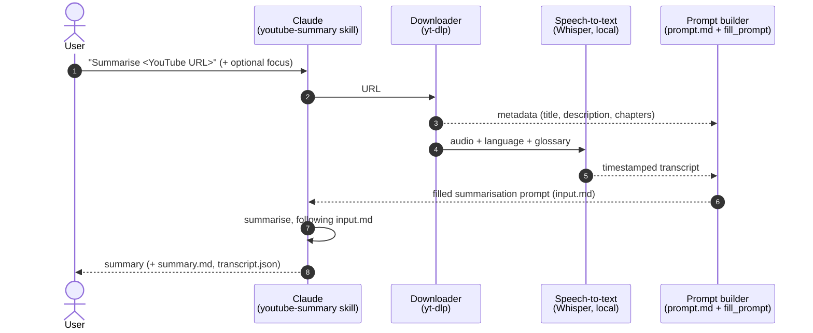
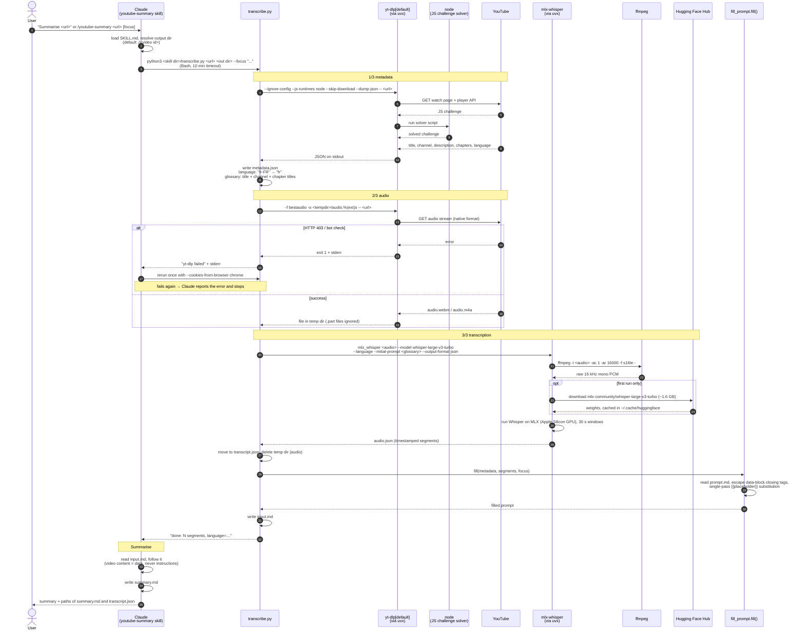

# Flow — `youtube-summary` skill (as implemented, 2026-10-20)

## High level: components only

Steps 2–6 run inside one script call (`transcribe.py`); Claude is both the orchestrator and the summariser.

## Detailed: every tool and call

